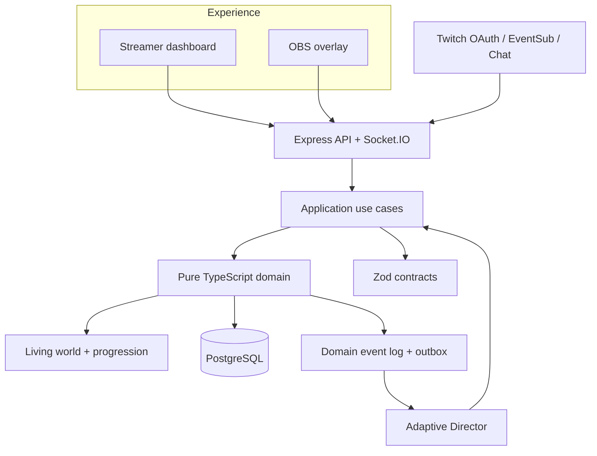

# Architecture overview

SIDEQUEST is a TypeScript modular monolith. Apps assemble adapters; packages express stable contracts and capabilities. PostgreSQL is the production persistence choice, with Drizzle and explicit SQL migrations. The local demo repository is intentionally in-memory.

## Dependency direction

`pnpm boundaries` enforces the workspace dependency allowlist, requires direct declarations for cross-package imports, and rejects dependency cycles. CI runs it through `pnpm lint`.

| Module              | May depend on                                           | Must not depend on                                          |
| ------------------- | ------------------------------------------------------- | ----------------------------------------------------------- |
| domain              | contracts, standard library                             | apps, application, persistence, intelligence, platform SDKs |
| contracts           | Zod                                                     | domain implementations, apps, infrastructure                |
| application         | domain, contracts                                       | Express, Socket.IO, Twitch SDK, Drizzle, OpenAI SDK         |
| twitch              | contracts                                               | domain mutation APIs, persistence                           |
| intelligence        | contracts, domain read models                           | direct state mutation, Twitch SDK, app code                 |
| persistence         | application ports, domain types                         | UI, Twitch, intelligence orchestration                      |
| apps/api            | application, contracts, adapters, config, observability | hidden cross-app imports                                    |
| dashboard / overlay | contracts, ui                                           | database and provider credentials                           |

## State transition path

1. A client or platform adapter receives an untrusted input.
2. The adapter parses its transport payload and normalizes it to a command.
3. The application validates the shared Zod command contract and invokes the domain.
4. The domain checks lifecycle, role, membership and contribution rules; it returns a new state plus ordered events.
5. A repository transaction stores the events, snapshot and outbox rows atomically.
6. The outbox publisher emits a versioned Socket.IO snapshot. Clients detect sequence gaps and request a snapshot.
7. AI consumes aggregate context and proposes a validated quest or narration. A subsequent command applies only approved, bounded content.

## Module responsibilities

- **Living World:** guild identity, player profiles, world history, achievements, relationships and artifacts. Durable history is authoritative; AI memory summaries are derived and replaceable.
- **Game Engine:** quest and encounter lifecycle, roles, actions, objectives, deterministic resolution and progression.
- **Adaptive Director:** quest proposals, narrative, pacing recommendations and historical interpretation, behind application-owned ports.
- **Twitch adapter:** OAuth, EventSub connection lifecycle, message parsing, moderation signals and outbound chat. No gameplay rules live here.
- **Realtime gateway:** authenticated dashboard/overlay channels, sequence-bearing state, snapshot recovery and read-only overlay credentials.
